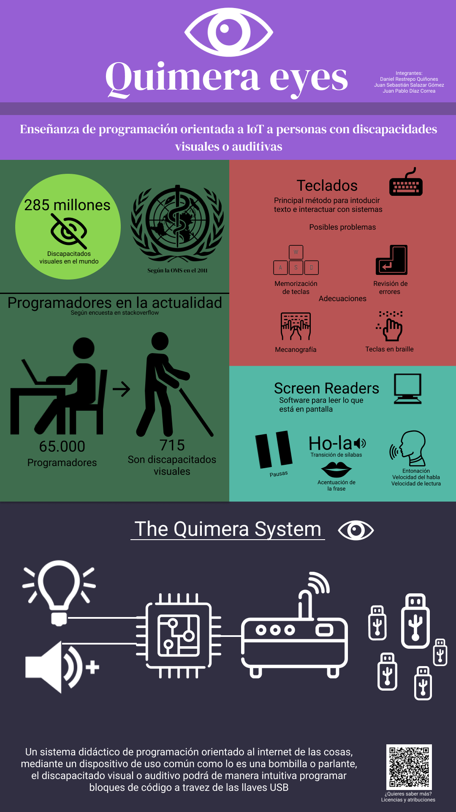

# Quimera Eyes 👁

_Programación en bloques basada en dispositivos USB para discapacitados visuales_

## Requisitos 🔑
* [Rasperry Pi 4 🍓](https://www.raspberrypi.org/) 

### Construido con 🛠
* [Python 3.7 🐍](https://www.python.org/downloads/release/python-370/)
* [JSON 🔤](https://www.json.org/json-es.html)

#### Librerías 📚
* [Pipenv](https://pypi.org/project/pipenv/)
* [RPi.GPIO](https://pypi.org/project/RPi.GPIO/)
* [json](https://docs.python.org/es/3.9/library/json.html)

#### Despliegue 🔌
Instalación de librerías
```
pienv install
```
Ejecución de código (con el entorno activado)
```
python3 main.py
```

#### Autores ✏
👨‍💻 Daniel Restrepo Quiñones - [@RQDaniL](https://github.com/RQDaniL) - daniel.restrepo53@eia.edu.co

👨‍💻 Juan Pablo Díaz Correa - [@Juanipis](https://github.com/Juanipis) - juan.diaz73@eia.edu.co

👨‍💻 Juan Sebastián Salazar Gómez - [@Khaalanidd](https://github.com/Khaalanidd) - juan.salazar23@eia.edu.co 

#### Poster 🧩


---

Hecho por [Juanipis](https://github.com/Juanipis) · [juanipis.xyz](https://juanipis.xyz)
